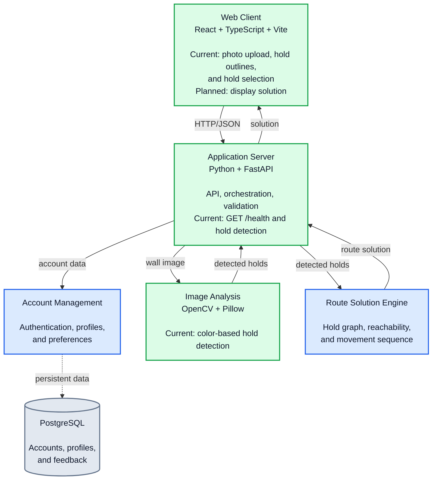
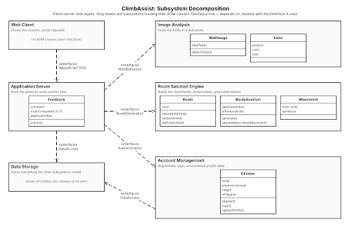

# Team Name
The Climbers

# Members

| Name | Title | GitHub | LinkedIn |
|---|---|---|---|
| Steven Rocca    |  Product Owner | [@stevenrocca3](https://github.com/stevenrocca3) | [Steven Rocca](https://www.linkedin.com/in/steven-rocca3/)     |
| Denys Tsinyk    |   Scrum Master | [@denystsinyk](https://github.com/denystsinyk)   | [Denys Tsinyk](https://www.linkedin.com/in/denystsinyk/)       |
| Roger Torres    |    Developer   | [@rTorresro](https://github.com/rTorresro)       | [Roger Torres](https://www.linkedin.com/in/rogertorresro/)     |                        |                
| Jayson Dang     |    Developer   | [@Zaku-Seven](https://github.com/Zaku-Seven)     | [Jayson Dang](https://www.linkedin.com/in/jbdang/)             |
| Samuel Gombiner |    Developer   | [@sgombiner](https://github.com/sgombiner)       | [Samuel Gombiner](https://www.linkedin.com/in/sam-gombiner/)   |

# Project Purpose
Help PittRec Center climbers by analyzing pictures of the climbing wall courses to display the most effective algorithm for completion.

# Tech Stack

| Area | Technology | Current status |
|---|---|---|
| Web client | React, TypeScript, Vite | Implemented photo upload, hold outlines, and hold selection |
| Application server | Python, FastAPI, Uvicorn | Implements `GET /health`, `POST /api/holds/detect`, and a standalone PostgreSQL connection check (`check_db.py`) |
| Image analysis | OpenCV, NumPy, Pillow | Basic color-based hold detection with known accuracy limitations |
| Route solution engine | Python service/module | Planned; the `route-solution-engine/` directory is currently a placeholder |
| Account management | PostgreSQL and authentication | Planned; the `account-management/` directory is currently a placeholder |

# Architecture

The Sprint 3 subsystem decomposition is shown below. The application server is
the integration point between the browser and the backend subsystems. In the
planned system, it will coordinate image analysis, route solving, and account
data stored in PostgreSQL.






The diagram describes the target architecture.

# Prerequisites

- Python 3.11 or newer (required by the pinned SQLAlchemy version in [`requirements.txt`](application-server/requirements.txt))
- `pip`
- Node.js and npm (developed with Node.js v22.23.4 and npm 10.9.9). The locked frontend tooling supports Node `^20.19.0 || >=22.12.0`.
- `curl` (for the health and upload checks)
- PostgreSQL 16 (tested with 16.15 in the server README), needed only for the database connection check

Installing the server requirements also installs Pillow, NumPy, OpenCV, and the upload parser used by hold detection.

# How to Run

## Application server

Run these commands from the repository root.

```bash
cd application-server
python3 -m venv .venv
source .venv/bin/activate
pip install -r requirements.txt
uvicorn app.main:app --reload --port 8000
```

On Windows PowerShell, use these commands from `application-server/` to create and activate the virtual environment. Then run the same `pip` and `uvicorn` commands.

```powershell
python -m venv .venv
.venv\Scripts\Activate.ps1
```

In a second terminal, run `curl http://localhost:8000/health`. The expected response is `{"status":"ok"}`.

For setup details and the PostgreSQL connection check, see the [Application Server README](application-server/README.md).

## Web client

Run these commands from the repository root in a separate terminal.

```bash
cd web-client
npm install
npm run dev -- --port 5173 --strictPort
```

Open <http://localhost:5173> and look for the ClimbAssist heading.

The API accepts browser requests from `http://localhost:5173` and `http://127.0.0.1:5173`. The command above keeps the client on port 5173 and reports an error if that port is occupied.

To check both components together, start the application server, then the web client, and open the same page. Upload a JPEG or PNG and press **Detect holds** to see outlined holds returned by the server.

For details on `VITE_API_URL` and other setup options, see the [Web Client README](web-client/README.md).

## API address and environment variables

The client uses `http://localhost:8000` by default. To use a different server address, set `VITE_API_URL` before starting the client from `web-client/`.

```bash
VITE_API_URL=http://localhost:8000 npm run dev -- --port 5173 --strictPort
```

In Windows PowerShell, use the equivalent commands.

```powershell
$env:VITE_API_URL = "http://localhost:8000"
npm run dev -- --port 5173 --strictPort
```

Restart the client after changing its API address. `DATABASE_URL` is required only when running `check_db.py`. Set it in the shell using the [database instructions](application-server/README.md#database).

## Check live detection

With the server running, run this command from the repository root to upload the included test image.

```bash
curl -F "file=@image-analysis/fixtures/representative-holds.png" http://localhost:8000/api/holds/detect
```

The response contains a `holds` array with each candidate's ID, color, and normalized bounding box. An image with no detected holds returns `{"holds":[]}`. In Windows PowerShell, use `curl.exe` for this upload command.

Press Ctrl+C in each terminal to stop the client and server when finished testing.

## Hold selection

1. Open <http://localhost:5173> and upload a photo, then press **Detect holds**. To try the interface without the server, press **Use sample wall**.
2. Click or tap a hold to select all detected holds of that color. Selected holds have a check mark and a stronger outline.
3. Click individual holds to add or remove them. The selected-hold count updates below the photo. Keyboard users can Tab to a hold and press Enter or Space.
4. Press **Clear selection** to choose a different color group. Replacing the photo, detecting again, loading the sample wall, or starting over resets the selection.

This implements the hold-selection part of issue #5 (`Refs #5`). Start/finish markers and route generation remain planned.

## Automated checks

Pull requests targeting `main` run the [CI workflow](.github/workflows/ci.yml).
It compiles the FastAPI server, tests health and hold detection, runs client tests
for hold validation, selection, and request cancellation, and builds the React client.
A next check could exercise the complete upload and selection flow in a browser.

From `application-server/`, with the server dependencies already installed and
the virtual environment active:

```bash
python -m pip install -r requirements-test.txt
python -m unittest discover -s tests -v
```

From `web-client/`, run `npm ci`, `npm test`, and `npm run build` to check the client.

# What Works / What Doesn't

**Works**

| Feature | What it does | How to use it |
|---|---|---|
| Photo upload and preview | Accepts JPEG/PNG photos up to 10 MiB, checks the file type and size, and displays a preview. | Choose a file using **Wall photo**. Choose another file to replace it before detection. |
| Hold detection and outlines | Returns candidate holds and draws labeled boxes on the uploaded photo. An empty result asks the climber to retake the photo. | Start the server and client, choose a photo, and press **Detect holds**. |
| Hold selection | Selects a color group, supports individual corrections and keyboard input, and displays the selected-hold count. | Click a hold to choose its color group, then click holds to add or remove them. See [Hold selection](#hold-selection). |
| Sample wall | Loads a checked-in demo image and predefined hold boxes so selection can be tried with the client alone. | Press **Use sample wall**. A notice identifies the sample data. Some detection failures also display this labeled sample wall. |
| Outdated-request cancellation | Prevents an old detection or sample response from overwriting the current photo, result, messages, or loading state. | Replace the photo while detection is pending. **Start over** clears the photo and results and cancels pending work. |
| Server health check | Reports whether the API responds with `{"status":"ok"}`. | With the server running, use `curl http://localhost:8000/health`. |
| PostgreSQL connection check | Runs a standalone database connectivity check and prints the result. | Follow the [database setup](application-server/README.md#database), set `DATABASE_URL`, and run `python check_db.py` from `application-server/`. |
| Automated checks | Runs server and client tests and builds the client in CI. | Follow [Automated checks](#automated-checks) locally, or inspect the checks on a PR targeting `main`. |

The current detector can miss holds or group large image regions together. Its accuracy limitations and outstanding detection target are documented in the [evaluation](docs/hold-detection-evaluation.md).

**Doesn't work yet**

- Start and finish markers
- Route Solution Engine
- Account Management
- Deployment beyond local machines

# Build Plan
We plan to build ClimbAssist as a web app with a React and TypeScript frontend, so climbers can use it from their phone’s browser without installing anything. The backend will be in Python using FastAPI, with OpenCV for image processing and PyTorch for the hold detection model, and PostgreSQL to store accounts and climber profiles. The thing we are least sure about is whether a pretrained model can find at least 75% of holds (NFR2) on real gym photos. If it can’t, we will have to label our own wall images and fine-tune the model, which could take a big part of Sprints 3 and 4.

# Repository Layout

- [`application-server/`](application-server/) - FastAPI health and hold-detection endpoints, plus the database connection check
- [`web-client/`](web-client/) - React/TypeScript photo upload, hold outlines, and selection with Vite
- [`image-analysis/`](image-analysis/) - basic OpenCV hold-detection subsystem
- [`route-solution-engine/`](route-solution-engine/) - planned route-solving subsystem
- [`account-management/`](account-management/) - planned accounts and profiles subsystem
- [`user-stories.md`](user-stories.md) - product requirements and acceptance criteria

# GenAI Usage

GenAI was used in code generation for this project.
