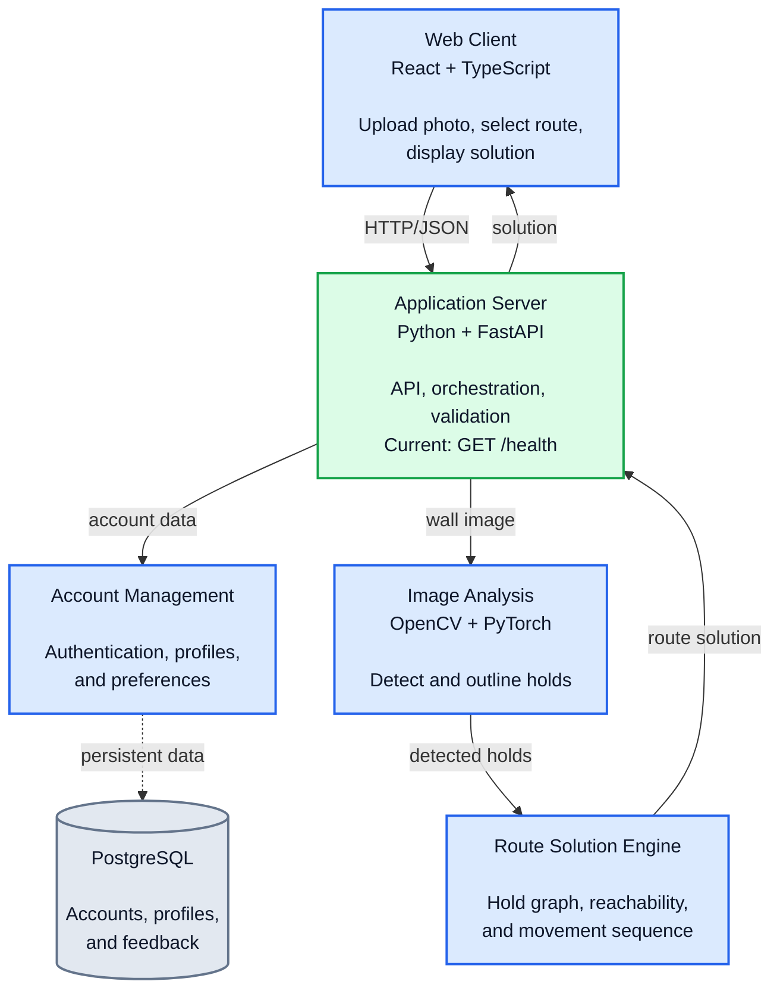

# Team Name
The Climbers

# Members

| Name | Title | GitHub | LinkedIn |
|---|---|---|---|
| Steven Rocca    |  Product Owner | [@stevenrocca3](https://github.com/stevenrocca3) | [Steven Rocca](https://www.linkedin.com/in/steven-rocca3/)     |
| Denys Tsinyk    |   Scrum Master | [@denystsinyk](https://github.com/denystsinyk)   | [Denys Tsinyk](https://www.linkedin.com/in/denystsinyk/)       |
| Roger Torres    |    Developer   | [@rTorresro](https://github.com/rTorresro)       | [Roger Torres](https://www.linkedin.com/in/rogertorresro/)     |                        |                
| Jayson Dang     |    Developer   | [@Zaku-Seven](https://github.com/Zaku-Seven)     | [Jayson Dang](https://www.linkedin.com/in/jbdang/)             |
| Samuel Gombiner |    Developer   | [@sgombiner](https://github.com/sgombiner)       | [Samuel Gombiner](https://www.linkedin.com/in/sam-gombiner/)   |

# Project Purpose
Help PittRec Center climbers by analyzing pictures of the climbing wall courses to display the most effective algorithm for completion.

# Tech Stack

| Area | Technology | Current status |
|---|---|---|
| Web client | React and TypeScript | Planned; the `web-client/` directory is currently a placeholder |
| Application server | Python 3.9.6, FastAPI, Uvicorn | Implemented skeleton with `GET /health` |
| Image analysis | OpenCV and PyTorch | Planned; the `image-analysis/` directory is currently a placeholder |
| Route solution engine | Python service/module | Planned; the `route-solution-engine/` directory is currently a placeholder |
| Account management | PostgreSQL and authentication | Planned; the `account-management/` directory is currently a placeholder |

# Architecture

The Sprint 3 subsystem decomposition is shown below. The application server is
the integration point between the browser and the backend subsystems. In the
planned system, it will coordinate image analysis, route solving, and account
data stored in PostgreSQL.



The diagram describes the target architecture. Currently, only the application
server skeleton and its health endpoint are implemented.

# Prerequisites

The currently runnable component requires:

- Python 3.9.6 or a compatible Python 3 installation
- `pip`
- `curl` (for the health check)

Node.js, npm, PostgreSQL, OpenCV, and PyTorch will be required when their
planned subsystems are implemented. They are not required to run the current
health-check server.

# How to Run

## Start the application server

From the repository root:

```bash
cd application-server
python3.9 -m venv .venv
source .venv/bin/activate
python -m pip install -r requirements.txt
uvicorn app.main:app --reload --port 8000
```

On systems where `python3.9` is not available, use `python3` if it points to
Python 3.9 or another compatible Python 3 installation.

## Check that it works

In a second terminal, run:

```bash
curl http://localhost:8000/health
```

The expected response is:

```json
{"status":"ok"}
```

The interactive API documentation is also available at
<http://localhost:8000/docs> while the server is running.

## Web client

The React/TypeScript client has not been implemented yet, so there is currently
no client install or start command. Once it is added, it will use the
`VITE_API_URL` value in `.env.example` to connect to the application server.

# Build Plan
We plan to build ClimbAssist as a web app with a React and TypeScript frontend, so climbers can use it from their phone’s browser without installing anything. The backend will be in Python using FastAPI, with OpenCV for image processing and PyTorch for the hold detection model, and PostgreSQL to store accounts and climber profiles. The thing we are least sure about is whether a pretrained model can find at least 75% of holds (NFR2) on real gym photos. If it can’t, we will have to label our own wall images and fine-tune the model, which could take a big part of Sprints 3 and 4.

# Repository Layout

- [`application-server/`](application-server/) - FastAPI backend skeleton
- [`web-client/`](web-client/) - planned React/TypeScript frontend
- [`image-analysis/`](image-analysis/) - planned hold-detection subsystem
- [`route-solution-engine/`](route-solution-engine/) - planned route-solving subsystem
- [`account-management/`](account-management/) - planned accounts and profiles subsystem
- [`user-stories.md`](user-stories.md) - product requirements and acceptance criteria
