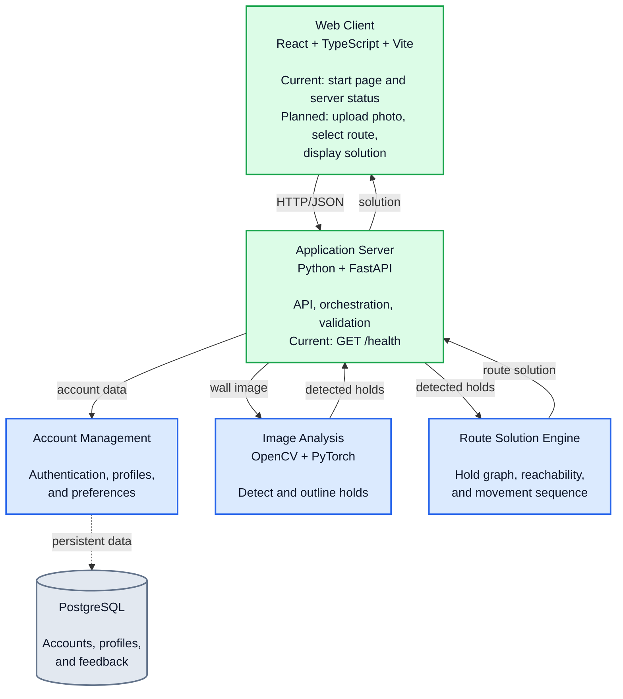
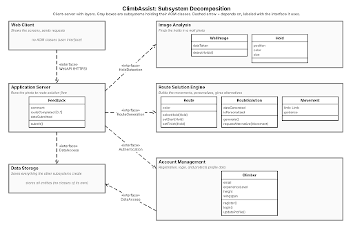
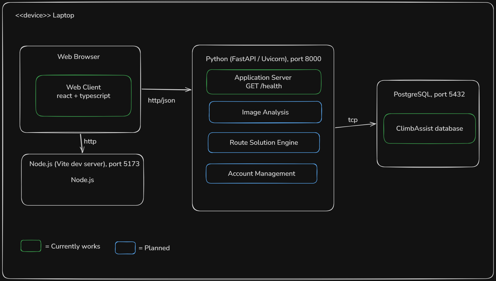

# Team Name
The Climbers

# Members

| Name | Title | GitHub | LinkedIn |
|---|---|---|---|
| Steven Rocca    |  Product Owner | [@stevenrocca3](https://github.com/stevenrocca3) | [Steven Rocca](https://www.linkedin.com/in/steven-rocca3/)     |
| Denys Tsinyk    |   Scrum Master | [@denystsinyk](https://github.com/denystsinyk)   | [Denys Tsinyk](https://www.linkedin.com/in/denystsinyk/)       |
| Roger Torres    |    Developer   | [@rTorresro](https://github.com/rTorresro)       | [Roger Torres](https://www.linkedin.com/in/rogertorresro/)     |                        |                
| Jayson Dang     |    Developer   | [@Zaku-Seven](https://github.com/Zaku-Seven)     | [Jayson Dang](https://www.linkedin.com/in/jbdang/)             |
| Samuel Gombiner |    Developer   | [@sgombiner](https://github.com/sgombiner)       | [Samuel Gombiner](https://www.linkedin.com/in/sam-gombiner/)   |

# Project Purpose
Help PittRec Center climbers by analyzing pictures of the climbing wall courses to display the most effective algorithm for completion.

# Tech Stack

| Area | Technology | Current status |
|---|---|---|
| Web client | React, TypeScript, Vite | Implemented start page that calls `GET /health` |
| Application server | Python, FastAPI, Uvicorn | Implemented skeleton with `GET /health` and a standalone PostgreSQL connection check (`check_db.py`) |
| Image analysis | OpenCV and PyTorch | Planned; the `image-analysis/` directory is currently a placeholder |
| Route solution engine | Python service/module | Planned; the `route-solution-engine/` directory is currently a placeholder |
| Account management | PostgreSQL and authentication | Planned; the `account-management/` directory is currently a placeholder |

# Architecture

The Sprint 3 subsystem decomposition is shown below. The application server is
the integration point between the browser and the backend subsystems. In the
planned system, it will coordinate image analysis, route solving, and account
data stored in PostgreSQL.







The diagram describes the target architecture.

# Prerequisites

- Python 3.11 or newer (required by the pinned SQLAlchemy version in [`requirements.txt`](application-server/requirements.txt))
- `pip`
- Node.js and npm (developed with Node.js v22.23.4 and npm 10.9.9)
- `curl` (for the health check)
- PostgreSQL 16 (tested with 16.15 in the server README), needed only for the database connection check

# How to Run

## Application server

Run these commands from the repository root.

```bash
cd application-server
python3 -m venv .venv
source .venv/bin/activate
pip install -r requirements.txt
uvicorn app.main:app --reload --port 8000
```

On Windows PowerShell, use these commands from `application-server/` to create and activate the virtual environment. Then run the same `pip` and `uvicorn` commands.

```powershell
python -m venv .venv
.venv\Scripts\Activate.ps1
```

In a second terminal, run `curl http://localhost:8000/health`. The expected response is `{"status":"ok"}`.

For setup details and the PostgreSQL connection check, see the [Application Server README](application-server/README.md).

## Web client

Run these commands from the repository root in a separate terminal.

```bash
cd web-client
npm install
npm run dev
```

Open <http://localhost:5173> and look for the ClimbAssist heading.

To check both components together, start the application server, then the web client, and open the same page. The page shows the server status (`ok` with a healthy server).

For details on `VITE_API_URL` and other setup options, see the [Web Client README](web-client/README.md).

# What Works / What Doesn't

**Works**

- The application server returns `{"status":"ok"}` from `GET /health`.
- The web client start page displays the result of the health check.
- The standalone `application-server/check_db.py` script checks a PostgreSQL connection using `DATABASE_URL`.

**Doesn't work yet**

- Image Analysis
- Route Solution Engine
- Account Management
- Deployment beyond local machines

# Build Plan
We plan to build ClimbAssist as a web app with a React and TypeScript frontend, so climbers can use it from their phone’s browser without installing anything. The backend will be in Python using FastAPI, with OpenCV for image processing and PyTorch for the hold detection model, and PostgreSQL to store accounts and climber profiles. The thing we are least sure about is whether a pretrained model can find at least 75% of holds (NFR2) on real gym photos. If it can’t, we will have to label our own wall images and fine-tune the model, which could take a big part of Sprints 3 and 4.

# Repository Layout

- [`application-server/`](application-server/) - FastAPI backend skeleton
- [`web-client/`](web-client/) - implemented React/TypeScript start page with Vite
- [`image-analysis/`](image-analysis/) - planned hold-detection subsystem
- [`route-solution-engine/`](route-solution-engine/) - planned route-solving subsystem
- [`account-management/`](account-management/) - planned accounts and profiles subsystem
- [`user-stories.md`](user-stories.md) - product requirements and acceptance criteria

# GenAI Usage

GenAI was used in code generation for this project.
