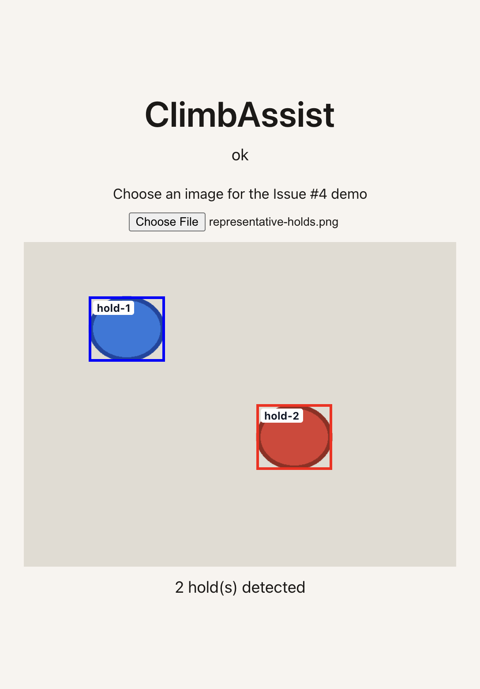
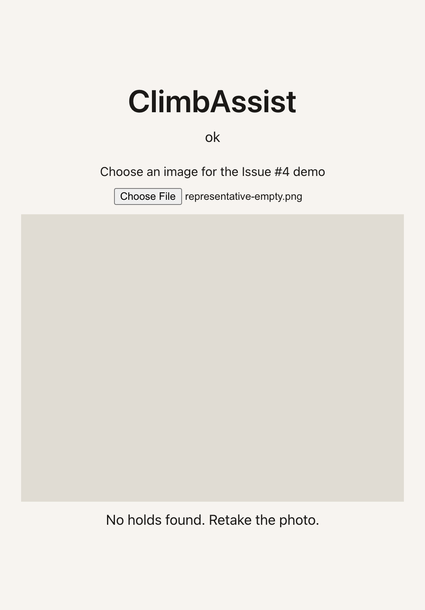

# Issue #4 Hold Detection Walkthrough

Refs #4

This walkthrough covers the hold detector, FastAPI contract, isolated demo, and
the smaller five-photo hold-detection test. The confirmed photograph was not in
the repository.

## 1. Create and enter the branch

```bash
cd /Users/samgombiner/Documents/GitHub/ClimbAssist
git switch -c feature/hold-detection
git --no-pager status --short --branch
```

Verify: the branch is `feature/hold-detection` and unrelated work remains outside
the commit stack.

## 2. Install backend dependencies

```bash
cd application-server
python3 -m venv .venv
source .venv/bin/activate
python -m pip install -r requirements.txt -r requirements-test.txt
```

Verify: `.venv` exists and the command exits successfully.

## 3. Start the API

```bash
cd application-server
source .venv/bin/activate
uvicorn app.main:app --reload --port 8000
```

In a second terminal, verify health and detection:

```bash
curl http://localhost:8000/health
curl -F "file=@../image-analysis/fixtures/representative-holds.png" \
  http://localhost:8000/api/holds/detect
```

Verify: health returns `{"status":"ok"}` and detection returns a `holds` array.

## 4. Verify no-hold behavior and errors

```bash
curl -F "file=@../image-analysis/fixtures/representative-empty.png" \
  http://localhost:8000/api/holds/detect
curl -F "file=@../application-server/README.md" \
  http://localhost:8000/api/holds/detect
```

Verify: the first response is `{"holds":[]}`. The unsupported-format test returns
HTTP 415 with a `detail` message.

## 5. Run backend tests

```bash
cd application-server
source .venv/bin/activate
python -m unittest discover -s tests -v
python -m compileall -q app
```

Verify: all server tests pass and the compile step has no output and exits zero.

## Re-run the five-photo smoke test

For a local detector-only smoke test, run:

```bash
cd application-server
source .venv/bin/activate
python - <<'PY'
import sys
from pathlib import Path

sys.path.insert(0, str(Path("..") / "image-analysis"))
from hold_detector import detect_holds

base = Path.home() / "Library/Application Support/Code/agentSessionData"
images = list(base.glob("*/attachments/*/*.png"))
for image in images:
    if "Pasted text" not in image.name:
        print(image.name, len(detect_holds(image.read_bytes())))
PY
```

Verify: the run reports `10`, `1`, `15`, `6`, and `5` detector candidates for
the five attached wall photos in the original attachment order. Use the labeled
totals of `6`, `31`, `25`, `6`, and `12` to calculate count-based percentages;
these percentages are not labeled IoU recall.

### Wall-photo demo screenshots

These screenshots show the local overlay with the restored saturated-color OpenCV detector:


## 6. Start the demo overlay

```bash
cd web-client
npm ci
npm run dev
```

Open `http://localhost:5173/#hold-detection-demo` while the API is running.



Choose `image-analysis/fixtures/representative-holds.png`. Verify two outlined
hold boxes and labels appear.

Choose `image-analysis/fixtures/representative-empty.png`.



Verify: the page shows `No holds found. Retake the photo.` and no outline is left
from the previous image.

## 7. Review and submit

```bash
cd web-client
npm ci
npm run build
npm run lint
git --no-pager diff --stat
git --no-pager status --short
```

Open the Issue #4 link: <https://github.com/stevenrocca3/ClimbAssist/issues/4>.
The PR should use the Sprint 5 CI template fields, include Issue #4, the test
commands and results, demo screenshots, CI status, and `@Denys` as reviewer.
Document that the current HSV pipeline reliably detects brightly colored holds
but does not work well on gray/monochrome or clear/transparent holds. Link the
baseline as `Refs #4`, and identify fine-tuning a pretrained model such as YOLOv8
on PyTorch with labeled wall images as the planned next step.
No Jayson photo PR was open at the time prepared, so validation and confirm/replace
review could not be performed until his PR exists.
